After getting my [heating and power usage/generation into EmonCMS](/blog?tag=emoncms) I wanted to start pulling other sources of data into EmonCMS, so I started looking for a more expandable method to bring multiple sources of data into EmonCMS.

Open Energy Monitor, the folks behind EmonCMS, have recently started [looking at Node-RED](http://openenergymonitor.blogspot.co.uk/2015/11/node-red-emoncms-node.html) so I decided to also have a look at this.

It is also getting colder and I wanted to get a bit more information on the operation of my OpenTRV board that has been sitting underused since the spring when I installed it on the radiator in the office.

## Getting Started

I won't go into detail about downloading/installing Node-RED as there are good instructions in the Node-RED [documentation](http://nodered.org/docs/getting-started/installation.html) and the [Node-RED EmonCMS Node](http://openenergymonitor.blogspot.co.uk/2015/11/node-red-emoncms-node.html) blog post includes instructions on installing the EmonCMS specific components.

First of all we need to get the data from the OpenTRV devices. In my setup this is via a USB to TTL adapter connected to the serial data port on the OpenTRV.

That is it for the hardware, but how do we get the data into Node-RED? For this we need the Serial node.

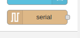

## Setting Up the Serial Connection

Drag one of these nodes to the workspace and double click to open the settings. You'll need to configure:

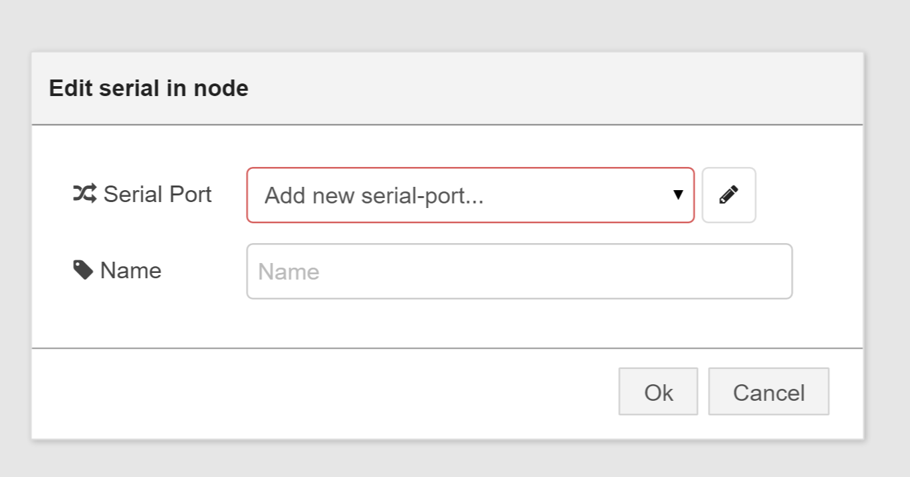

- **Serial Port**: The COM port your USB-TTL adapter is connected to
- **Baud Rate**: Typically 4800 for OpenTRV devices
- **Data Bits**: 8
- **Parity**: None
- **Stop Bits**: 1

## Data Processing

The OpenTRV devices output status information in a structured format that includes temperature readings, valve positions, and other sensor data. Node-RED provides excellent tools for parsing this data:

### Switch Node
Use a switch node to route different types of messages based on content patterns.

### Function Nodes
Create custom JavaScript functions to parse the OpenTRV status strings and extract meaningful data points.

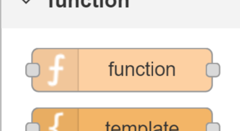

### Debug Nodes
Essential for monitoring data flow and troubleshooting your Node-RED flows.

## Integration with EmonCMS

Once you have the data parsed and formatted, the EmonCMS node makes it simple to send the data to your EmonCMS instance:

1. **Install the EmonCMS Node**: Use the Node-RED palette manager
2. **Configure Connection**: Set your EmonCMS server URL and API key
3. **Map Data**: Ensure your parsed data matches the expected EmonCMS format

## Benefits of Node-RED

Using Node-RED for IoT data integration provides several advantages:

- **Visual Programming**: Flow-based programming makes complex data processing easier to understand
- **Extensive Library**: Thousands of contributed nodes for different protocols and services
- **Real-time Processing**: Live data transformation and routing
- **Easy Debugging**: Built-in debugging tools and message inspection
- **Flexible Deployment**: Can run on Raspberry Pi, local servers, or cloud platforms

## Next Steps

This initial experiment with Node-RED has opened up many possibilities for expanding my home automation and monitoring system. Future posts will explore:

- Handling multiple OpenTRV nodes
- Adding other sensor data sources
- Creating custom dashboard interfaces
- Advanced data processing and alerting

Node-RED proves to be an excellent tool for bridging different IoT protocols and services, making it much easier to create comprehensive monitoring and automation systems.

## Images

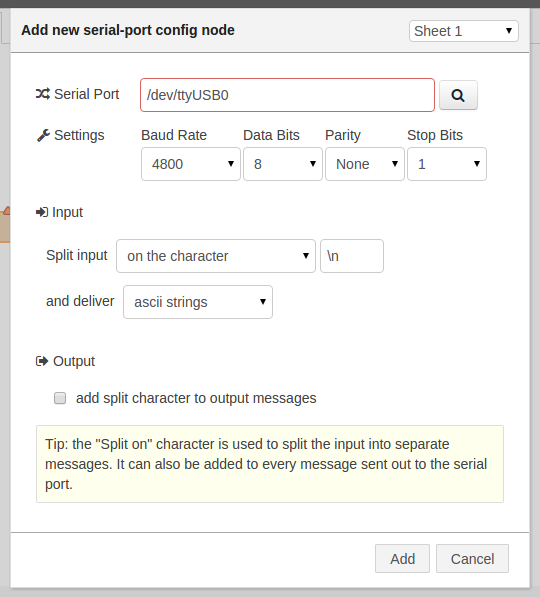

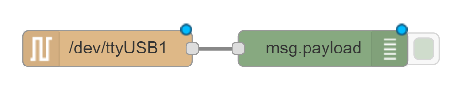

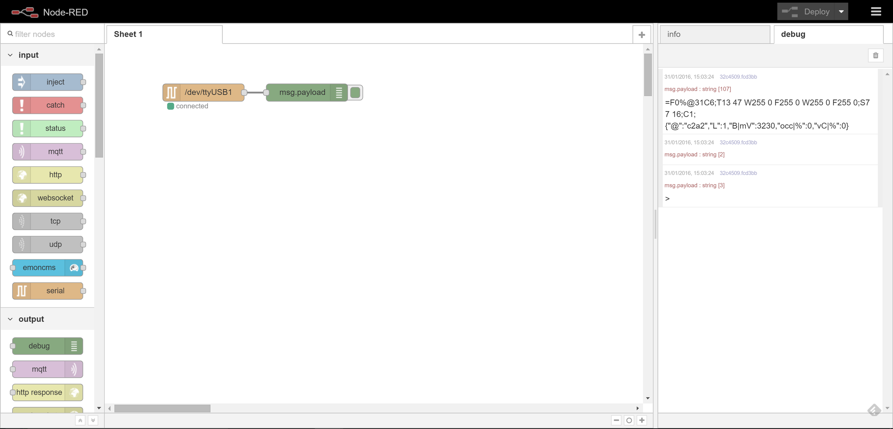

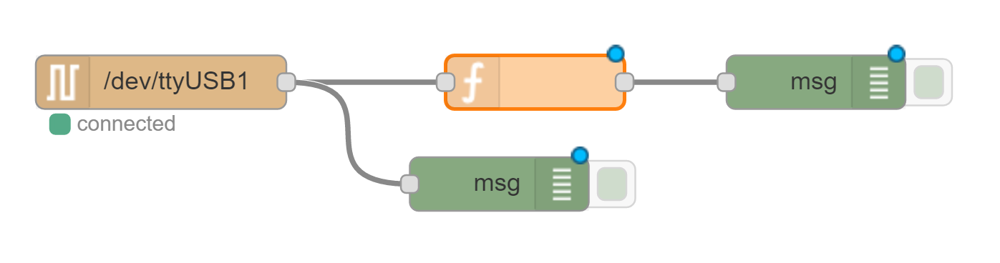

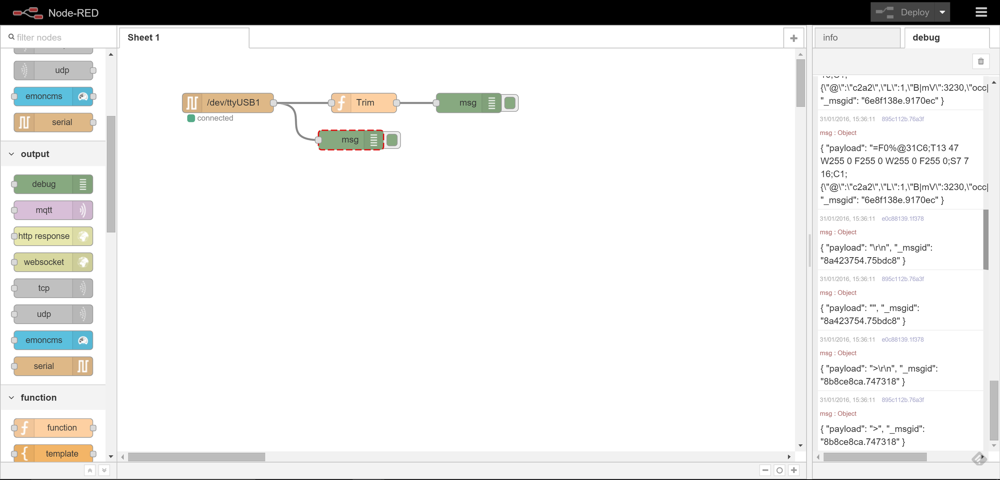

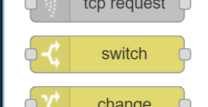

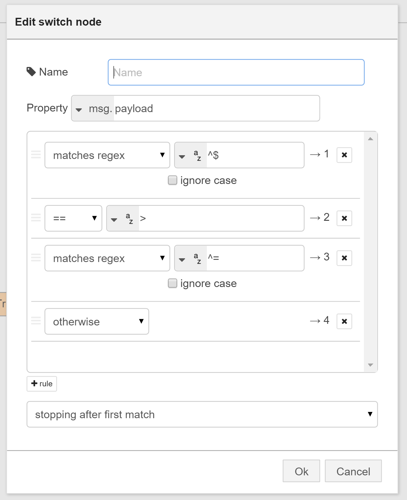

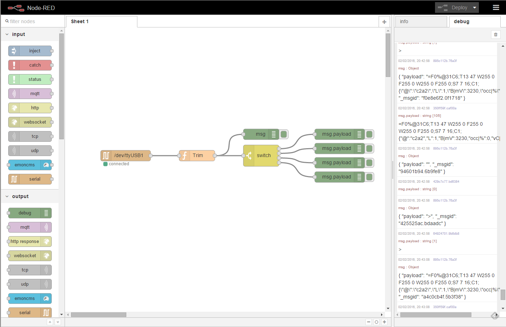

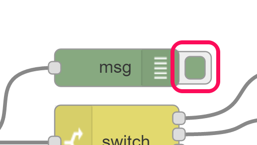

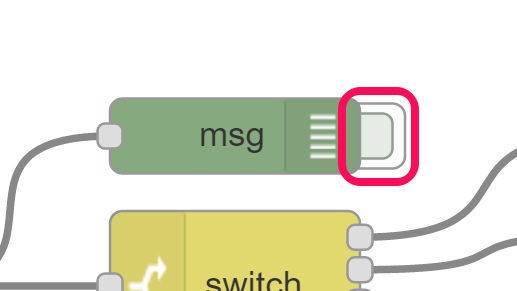

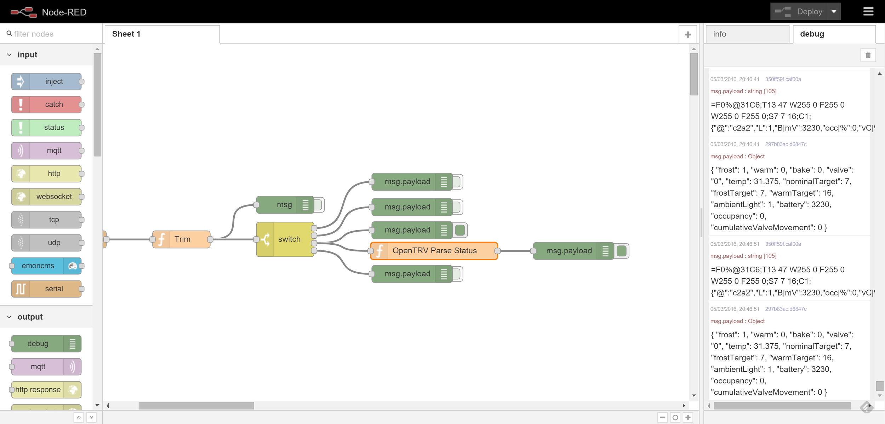

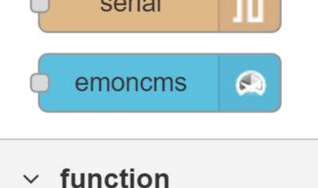

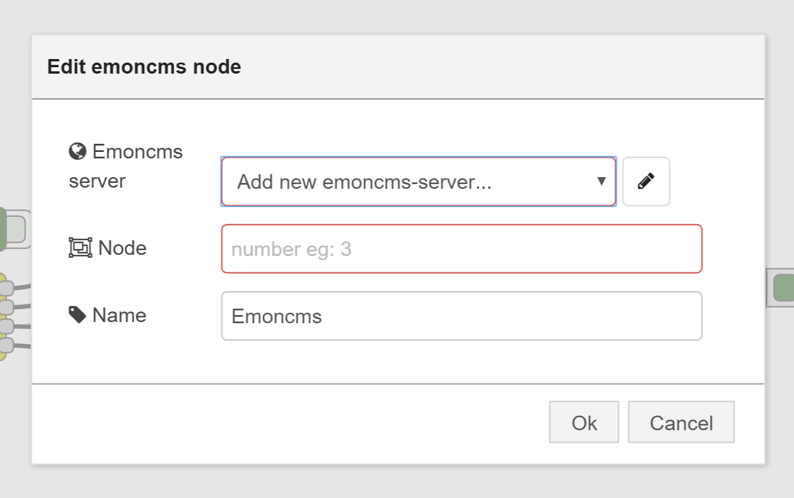

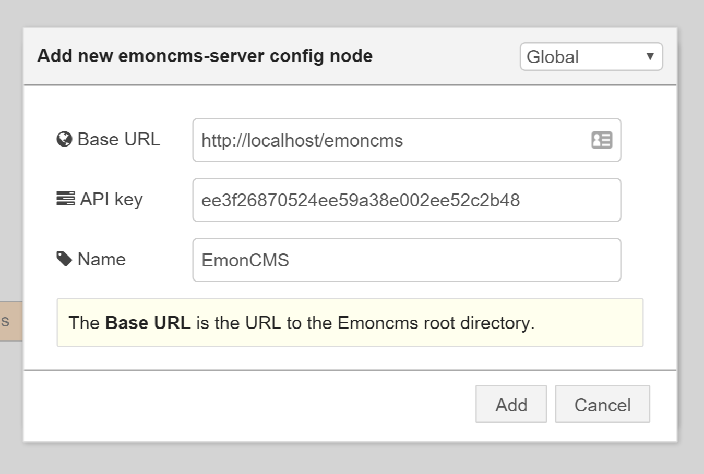

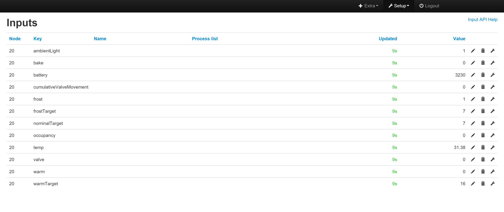
